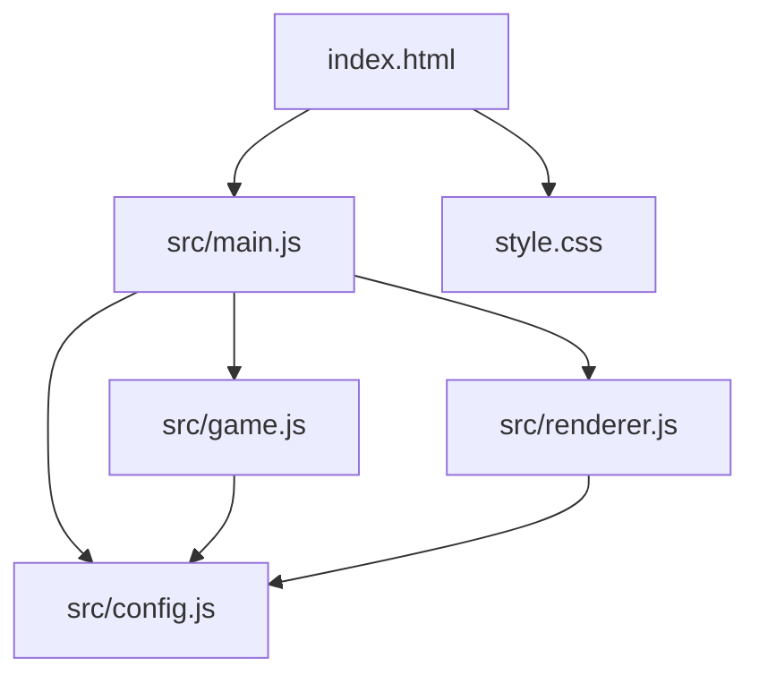
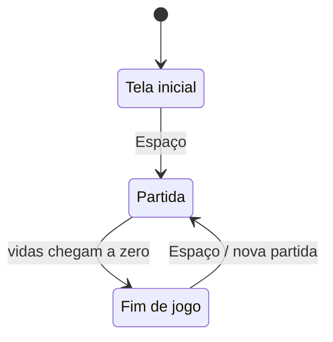

# Design: Chuva de Bugs

## Visão geral
O jogo será uma página estática com um canvas de resolução lógica fixa, controlado por JavaScript puro e ES modules. `main.js` conecta eventos de teclado, atualização da partida e desenho em um loop com `requestAnimationFrame`. `game.js` contém estado, regras, colisões, dificuldade e recorde; `renderer.js` desenha as telas e os elementos do jogo. Os valores ajustáveis ficam reunidos em `CONFIG`, e o CSS centraliza a área de jogo sem dependências externas.

## Decisões técnicas
| Decisão | Escolha | Por quê |
|---|---|---|
| Renderização | Canvas 2D; personagens e itens com emojis desenhados por `fillText` | Atende ao visual previsto usando os recursos da stack fixa. |
| Área do jogo | Resolução lógica de 640 × 480; CSS reduz a apresentação em telas estreitas sem alterar a resolução do canvas | Mantém limites e proporções previsíveis e a área centralizada. |
| Loop | `requestAnimationFrame`, delta time em segundos e limite de 0,05 s por quadro | Mantém o movimento independente da taxa de quadros e evita saltos ao retornar à aba. |
| Movimento e colisão | Movimento horizontal contínuo; caixas retangulares simples para colisões | É suficiente para a mecânica e fácil de entender e ajustar. |
| Aumento de dificuldade | Velocidade cresce com o tempo até um limite; intervalo de surgimento diminui até um mínimo | Garante progressão sem tornar os valores ilimitados. |
| Recorde | `localStorage`, atualizado quando a pontuação ultrapassa o recorde | Persiste no navegador sem login ou serviço externo. |
| Compatibilidade | HTML, CSS e JavaScript nativos, imports e referências relativos | Funciona em hospedagem estática, inclusive em subcaminho no GitHub Pages. |

## Arquitetura


## Estrutura de arquivos
```text
index.html             Documento da página e elemento canvas.
style.css              Fundo escuro e centralização responsiva do canvas.
src/
  config.js             Valores ajustáveis exportados pelo objeto CONFIG.
  main.js               Inicialização, teclado e loop principal.
  game.js               Estado e regras da partida, incluindo o recorde.
  renderer.js           Desenho das telas e dos elementos no canvas.
```

## Componentes
### `index.html`: página do jogo
- **Responsabilidade:** definir a página, carregar `style.css`, declarar o canvas e carregar `src/main.js` como módulo com caminho relativo.
- **Estado:** nenhum; o estado da partida pertence a `game.js`.
- **Funções principais:** nenhuma.
- **Atende:** 7.2.

### `style.css`: apresentação da página
- **Responsabilidade:** aplicar fundo escuro com aparência de editor e centralizar o canvas; permitir que ele encolha visualmente em telas estreitas, preservando sua proporção.
- **Estado:** nenhum.
- **Funções principais:** nenhuma.
- **Atende:** 7.2.

### `src/config.js`: configuração central
- **Responsabilidade:** exportar um único objeto `CONFIG` com dimensões, velocidades, tamanhos, cores, textos, tempos, probabilidades e chave do armazenamento.
- **Estado:** nenhum.
- **Funções principais:** nenhuma.
- **Atende:** 2.3, 3.1, 4.3, 4.1, 5.1, 5.2, 7.1, 7.2.

### `src/main.js`: inicialização e entrada
- **Responsabilidade:** obter o canvas, aplicar suas dimensões lógicas, inicializar todas as teclas como liberadas, registrar eventos de teclado e coordenar atualização e desenho.
- **Estado:** referência ao contexto 2D, estado da partida, teclas pressionadas e instante do quadro anterior.
- **Funções principais:** `startApplication()`: prepara canvas, estado e loop; `handleKeyDown(event)`: inicia ou reinicia com Espaço e registra as teclas; `handleKeyUp(event)`: libera as teclas; `frame(timestamp)`: calcula delta time, atualiza a partida, desenha e agenda o próximo quadro.
- **Atende:** 1.2, 1.4, 2.1, 2.2, 7.2.

### `src/game.js`: regras da partida
- **Responsabilidade:** controlar telas/estados, jogador, itens, pontuação, vidas, colisões, surgimento, progressão da dificuldade e recorde persistido.
- **Estado:** estado atual (`inicio`, `jogando` ou `fim`), tempo de partida, pontuação, recorde, vidas, posição do dev, itens ativos e tempo até o próximo surgimento.
- **Funções principais:** `createGame()`: cria todos os valores iniciais e carrega o recorde; `startGame(game)`: inicia ou reinicia a partida com pontuação zerada e vidas iniciais; `updateGame(game, input, deltaSeconds)`: move o dev, atualiza itens, resolve colisões, dificuldade e fim de jogo.
- **Atende:** 1.2, 1.3, 1.4, 2.1, 2.2, 2.3, 3.1, 3.2, 4.1, 4.2, 4.3, 5.1, 5.2, 6.1, 6.2, 6.3.

### `src/renderer.js`: desenho no canvas
- **Responsabilidade:** desenhar a tela inicial, a partida (incluindo pontuação e vidas) ou a tela final, usando emojis e textos em português.
- **Estado:** nenhum; recebe o estado atual para desenhá-lo.
- **Funções principais:** `renderGame(context, game)`: limpa e desenha a tela adequada ao estado, o dev, os itens e as informações visíveis.
- **Atende:** 1.1, 1.3, 1.4, 3.1, 7.1, 7.2.

## Configuração central (`CONFIG` em `src/config.js`)
| Constante | Valor inicial | Para que serve | Atende |
|---|---:|---|---|
| `canvas.width` / `canvas.height` | 640 / 480 | Resolução lógica da área de jogo | 2.3, 3.1, 7.2 |
| `player.speed` | 300 px/s | Velocidade horizontal do dev | 2.1, 2.2 |
| `player.size` / `player.bottomOffset` | 34 px / 42 px | Tamanho desenhado e distância do dev ao limite inferior | 2.3, 7.1 |
| `player.emoji` | `🧑‍💻` | Representação do dev | 7.1 |
| `item.size` | 30 px | Tamanho desenhado e hitbox dos itens | 3.1, 3.2 |
| `item.coffeeEmoji` / `item.bugEmoji` | `☕` / `🐛` | Representação dos itens | 7.1 |
| `item.coffeeProbability` | 0,6 | Chance de um item ser café; o restante são bugs | 3.1 |
| `item.initialFallSpeed` / `item.maxFallSpeed` | 120 / 360 px/s | Velocidade inicial e limite de queda | 3.1, 5.1 |
| `item.fallSpeedIncrease` | 8 px/s por segundo | Aumento gradual da velocidade de queda | 5.1 |
| `spawn.initialInterval` / `spawn.minInterval` | 0,9 / 0,3 s | Intervalo inicial e mínimo entre itens | 3.1, 5.2 |
| `spawn.intervalDecrease` | 0,02 s por segundo | Redução gradual do intervalo | 5.2 |
| `game.initialLives` / `game.pointsPerCoffee` | 3 / 1 | Vidas por partida e pontos por café | 4.1, 4.3, 6.2 |
| `game.recordStorageKey` | `chuva-de-bugs-record` | Chave para carregar e salvar o recorde | 6.3 |
| `loop.millisecondsPerSecond` / `loop.maxDeltaSeconds` | 1000 / 0,05 | Conversão do timestamp e limite do delta time | 5.1, 5.2 |
| `visual.backgroundColor` / `visual.textColor` | `#101820` / `#e6edf3` | Fundo e texto desenhados no canvas | 1.1, 1.3, 1.4, 7.2 |
| `visual.fontFamily` | `monospace` | Fonte dos textos no canvas | 1.1, 1.3, 1.4, 7.2 |

## Fluxo


Em cada quadro do loop principal:
1. `main.js` calcula o tempo decorrido em segundos e limita o delta time.
2. Se a partida estiver ativa, `game.js` atualiza a posição do dev conforme as teclas pressionadas.
3. `game.js` atualiza a velocidade e o intervalo de surgimento com o tempo da partida, cria itens quando necessário e move os itens ativos.
4. `game.js` verifica colisões: café soma pontos e é removido; bug retira uma vida e é removido. Ao ultrapassar o recorde, salva o novo valor.
5. Itens que chegam ao chão sem colisão são removidos sem alterar pontuação ou vidas. Quando as vidas chegam a zero, o estado passa para fim de jogo.
6. `renderer.js` desenha a tela correspondente ao estado atualizado; `main.js` agenda o quadro seguinte.

## Propriedades de corretude
- Para qualquer atualização da partida, a posição horizontal do dev permanece entre os limites esquerdo e direito do canvas. (Valida: 2.3)
- Para qualquer item criado, sua posição horizontal permanece dentro do canvas e sua posição vertical avança em direção ao chão enquanto a partida está ativa. (Valida: 3.1)
- Para qualquer item, uma colisão o processa uma única vez; cafés somam 1 ponto, bugs retiram 1 vida e itens que chegam ao chão sem colisão não alteram esses valores. (Valida: 3.2, 4.1, 4.2)
- Para qualquer partida, as vidas começam em 3 e nunca ficam abaixo de zero; ao chegar a zero, a partida entra no estado de fim. (Valida: 4.3, 6.1)
- Para qualquer recorde salvo, o valor persistido é igual ou superior ao recorde carregado anteriormente. (Valida: 6.3)

## Casos limite
- Se esquerda e direita forem pressionadas ao mesmo tempo, o movimento horizontal é cancelado naquele quadro.
- Se o dev tocar vários itens no mesmo quadro, cada item é resolvido uma vez; ao perder a última vida, o estado muda para fim e não há novas atualizações da partida.
- Se a aba ficar inativa por algum tempo, o delta time limitado evita que o dev ou os itens atravessem a área em um único quadro.
- Se o armazenamento local estiver indisponível ou retornar um valor inválido, o jogo continua com recorde em memória durante a sessão; assume-se armazenamento local disponível para persistência entre visitas.
